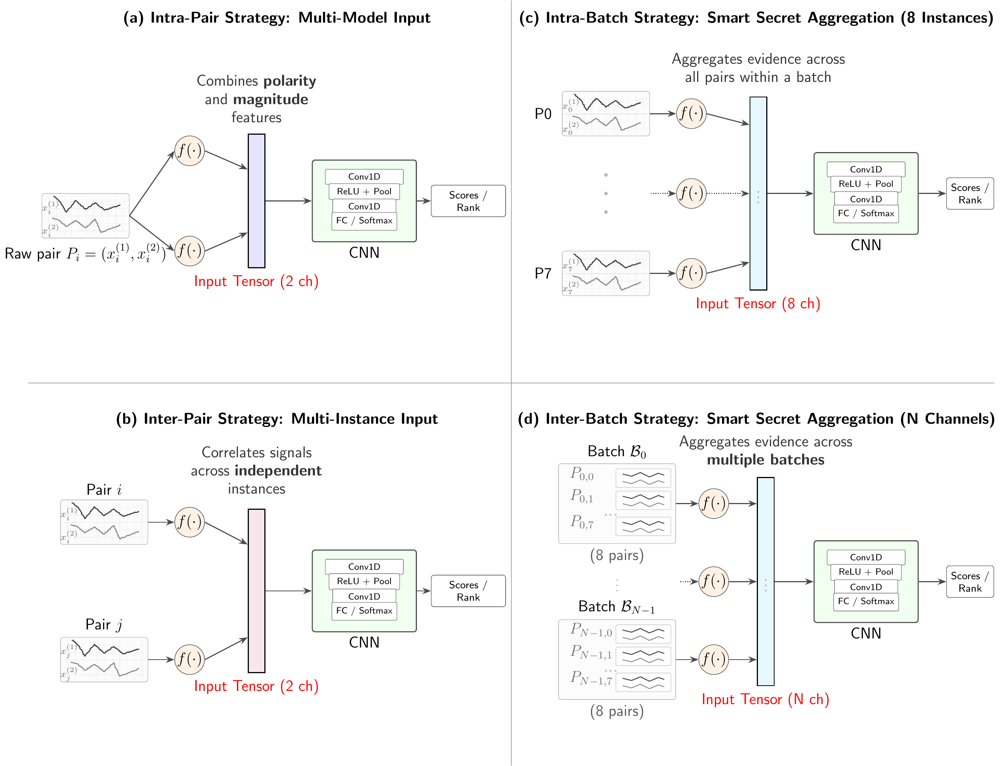

# Mind Your Oblivious Transfer (OT) Extensions Deployed in the Real-world

### Supplementary Research Materials — CASCADE 2027

**Authors:** Tommy Levi¹, Francesco Berti², Itamar Levi¹

¹ Bar-Ilan University, Israel  
² Royal Military Academy, Belgium

---

## Overview

This repository accompanies our paper **"Mind Your Oblivious Transfer (OT) Extensions Deployed in the Real-world,"** accepted for publication at CASCADE 2027.

Our research investigates physical side-channel leakage in practical implementations of the IKNP Oblivious Transfer Extension protocol, focusing on how correlations across related cryptographic computations can amplify exploitable leakage.

We evaluate three attack strategies: intra-pair, inter-pair, and intra-batch, using profiled side-channel analysis and machine-learning techniques.

This repository provides supplementary experimental documentation, additional evaluation results, and methodological details intended to support research transparency and reproducibility.

**The published paper is self-contained.** The materials provided here are complementary and are not required to understand its main contributions, methodology, or conclusions.

## Methodology Overview

Our evaluation explores protocol-induced correlations at different levels of granularity, progressing from individual paired executions to neighboring pairs and full eight-pair batches.

**Protocol-aware attack strategies.** The diagram illustrates four levels of leakage aggregation:

- **(a) Intra-pair:** Combines complementary transformations of two traces from the same paired execution into a multi-channel representation.
- **(b) Inter-pair:** Fuses trace representations from neighboring pairs to exploit cross-instance correlations.
- **(c) Intra-batch:** Aggregates evidence across all eight pairs within a batch, where the underlying secret relation remains fixed.
- **(d) Inter-batch:** Illustrates a conceptual extension in which evidence is aggregated across multiple batches. This strategy is presented as a potential research direction and was not experimentally evaluated in the paper.

The evaluated strategies exploit known relationships between paired executions and, where applicable, deterministic XOR offsets induced by the protocol and counter structure.

## Repository Contents

### 1. AESPTv2 Baseline Evaluation

Supplementary experiments using the public AESPTv2 dataset, including:

- CNN and LSTM profiling experiments.
- Comparisons with and without SMOTE augmentation.
- Guessing Entropy (GE) and Success Rate (SR) evaluation.
- Additional performance figures and experimental results.

### 2. Machine-Learning Experimental Configurations

Additional documentation of the machine-learning experiments, including:

- Neural-network architectures and input representations.
- Training hyperparameters and preprocessing procedures.
- Profiling and attack-evaluation configurations.
- Details of the experimental evaluation methodology.

### 3. Classical Profiled-Attack Baseline

Additional results from the classical Multivariate Gaussian Template Attack evaluated against the single-pair differential leakage setting, including:

- Template construction and point-of-interest selection.
- Key-hypothesis scoring methodology.
- Guessing Entropy and top-k Success Rate measurements.
- Comparison with the corresponding CNN-based approach.

### 4. Experimental Diagnostics of Lightweight Countermeasures

Supplementary experimental analysis of the cyclic-shift and coded-index countermeasures presented in the accompanying paper, including:

- Success-rate behavior across different effective-delta values.
- Distribution of final candidate ranks under cyclic-shift protection.
- Comparison of Guessing Entropy (GE) and Success Rate (SR) across protected and unprotected configurations.
- Extended coded-index evaluation over larger attack-example budgets.

These diagnostics provide additional insight into the empirical behavior of the proposed countermeasures.

## Publication

**Paper:** Mind Your Oblivious Transfer (OT) Extensions Deployed in the Real-world  
**Conference:** CASCADE 2027
